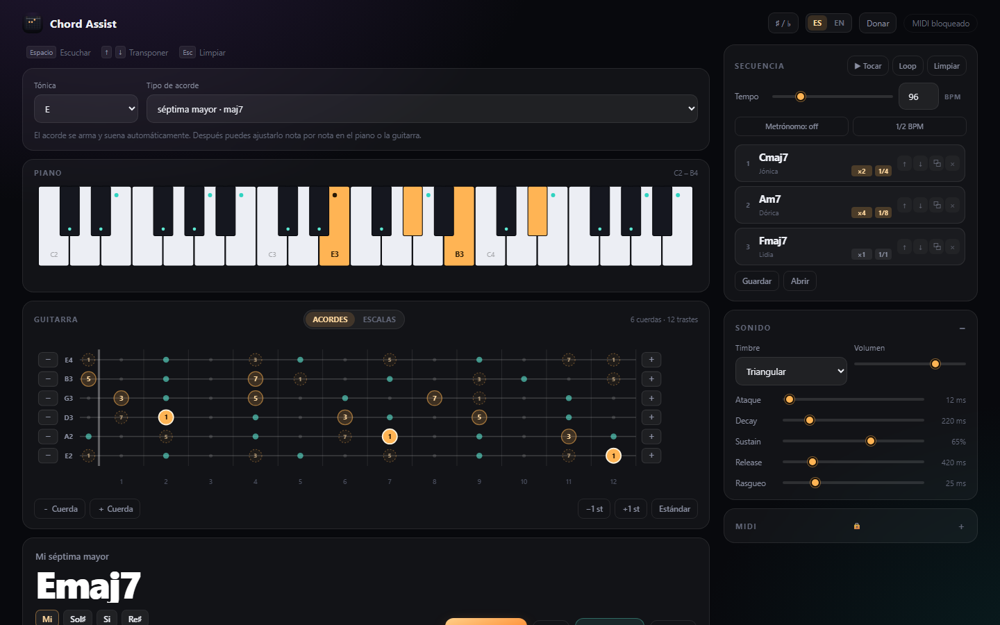

# Chord Assist

Arma acordes de dos maneras —tocando notas en el piano o el diapasón, o eligiendo tónica y tipo—, mira qué escalas y modos encajan, y encadénalos en una secuencia editable. El nombre se muestra en cifrado americano, todo suena por un sintetizador propio y sale por MIDI.

Interfaz en **castellano neutro** e **inglés** (botón ES / EN). App web standalone, sin build ni dependencias.



## Cómo abrirla

**Opción rápida:** doble clic en `index.html`. Funciona offline, con sonido.


## La interfaz

Arriba de todo están los atajos (**Espacio** escuchar, **↑ ↓** transportar, **Esc** limpiar). Debajo, la caja de **tónica + tipo de acorde** siempre visible, el **piano**, la **guitarra**, el **acorde actual** y las **escalas**.

### Formato 1 · Notas

Cada clic en el piano o el diapasón suma o saca una nota, suena, y el acorde se va nombrando solo.

- **Piano**: 3 octavas (C2–B4). Las notas elegidas quedan en ámbar con su nombre y octava.
- **Guitarra**: 12 trastes. Los puntos grandes son las notas exactas que elegiste (con su **grado**: `1`, `3`, `5`, `♭7`…). Los chicos marcan el resto de las posiciones del acorde; también se pueden tocar.
- **Cifrado**: si el acorde está invertido aparece con barra (`C/E`) y el bajo se pinta en rojo.

### Afinación y cuerdas

Cada cuerda tiene **−** y **+** a los costados para bajarla o subirla un semitono, con su nota al lado (`E4`, `D♯2`…). Abajo del diapasón:

- **－ Cuerda / ＋ Cuerda**: de 4 a 8 cuerdas.
- **−1 st / +1 st**: transporta **toda** la afinación de una vez. Para una guitarra en D♯ estándar alcanza con un clic en −1 st.
- **Estándar**: vuelve a E–A–D–G–B–E.

La afinación queda guardada en el navegador y se puede compartir por URL: `#tune=63,58,54,49,44,39`.

### Formato 2 · Tónica + tipo

Dos cajas: **tónica** (C…B) y **tipo de acorde** (46 tipos agrupados en tríadas, suspendidos, mayores, menores y dominantes). Al cambiar cualquiera, el acorde se arma y suena. Después puedes ajustarlo nota por nota en el piano o la guitarra.

## Escalas y modos

Debajo del acorde aparecen las escalas que contienen todas sus notas, de la más idiomática a la más exótica. Sobre `Cmaj7`: *Jónica*, *Lidia*, *Mayor armónica*…; sobre `C7`: *Mixolidia*, *Lidia dominante*, *Frigia dominante*…

- **Ámbar** = notas del acorde · **Verde agua** = notas de la escala que no están en el acorde · **Gris** = fuera de la escala.
- **▶ Escala** la toca subiendo y bajando una octava, al tempo del panel (también por MIDI).

**Buscador de escalas.** En la tarjeta de la guitarra hay un selector **Acordes / Escalas**:

- En **Acordes**, las sugerencias son las que contienen el acorde, con tónica en su raíz.
- En **Escalas**, agregas **3 o más notas** y te muestra **todas las escalas de cualquier tónica** que las contengan. Ejemplo: `C D E` → *C pentatónica mayor*, *A pentatónica menor*, *D egipcia*, *C jónica*, *D dórica*…

Además, la fila **Buscar** permite elegir a mano cualquier tónica y escala de la biblioteca.

### Biblioteca (37 escalas)

Los siete modos griegos, menor armónica y melódica, pentatónicas, blues, tonos enteros, disminuidas (T–S y S–T), alterada, frigia dominante, lidia dominante, locria ♮2, mayor armónica, dórica ♭2, mixolidia ♭6, lidia aumentada, aumentada, overtone, ultralocria, doble armónica, persa, egipcia, española de 8 notas, japonesa 1 y 2, iwato, hirajoshi 1 y 2, china y kumoi.

## Secuencia

- **＋ Agregar** apila el acorde **junto con la escala elegida**.
- Clic en un paso: lo carga (con su escala) y lo toca.
- Cada paso tiene dos controles:
  - **×1 / ×2 / ×4** = **cuántos compases** ocupa el acorde. Con ×4 el acorde suena durante 4 compases.
  - **1/1 · 1/2 · 1/4 · 1/8** = **la figura con la que se golpea** dentro de esos compases: redonda (una vez por compás), blanca (dos), negra (cuatro) o corchea (ocho).
  - Ejemplo: `Emaj7 ×4` con `1/4` suena 16 veces (4 compases × 4 negras) sin tener que copiar el paso.
- **↑ ↓** para moverlo, **⧉** para copiarlo y **×** para borrarlo.
- **▶ Tocar** reproduce toda la secuencia al tempo del panel; **Loop** la repite.
- **⇩ Guardar / ⇧ Abrir**: descarga la secuencia en JSON (con acordes, escalas, compases, figuras, BPM y afinación) o la vuelve a cargar.

## Metrónomo

Al lado del tempo hay dos botones:

- **Metrónomo**: alterna entre **off**, **secuencia** (solo suena mientras se reproduce la secuencia) y **siempre**. Sin acento en el primer tiempo: todos los clics suenan igual.
- **1/2 BPM**: el metrónomo va a la mitad de la velocidad de los acordes.

## Tempo

El tempo va de **40 a 300 BPM** y se puede escribir el número exacto, igual que en un DAW. Afecta al acorde en loop, a la escala y a la secuencia.

## Loop del acorde

**⟳ Loop** al lado de *Escuchar* repite el acorde indefinidamente (también por MIDI): elige el acorde, activa Loop, dale ▶ y practica la escala encima.

## Atajos

| Tecla | Acción |
|---|---|
| `Espacio` | escuchar / detener el acorde |
| `Enter` | agregar a la secuencia |
| `↑` `↓` | transportar el acorde |
| `Esc` | limpiar (y cerrar el modal) |

## Enlaces directos (presets por URL)

```
index.html#notes=48,52,55,59                       → Cmaj7 en el piano
index.html#type=maj13&root=2                       → Dmaj13 desde el selector
index.html#notes=48,50,52&search=scales            → buscador de escalas con C D E
index.html#seq=0:maj7:2:ionian:1|9:m7:4:dorian:0.5  → Cmaj7 2 compases en negras | Am7 4 compases en corcheas
index.html#tune=63,58,54,49,44,39                  → guitarra en D♯ estándar
index.html#lang=en                                 → interfaz en inglés
index.html#modal=1                                 → ver el modal de donaciones
```

- `notes`: notas MIDI (C4 = 60), separadas por coma
- `type`: id del diccionario (`maj`, `min`, `dom7`, `maj7`, `m7`, `m7b5`, `13s11`…)
- `root`: 0 (C) a 11 (B)
- `search`: `scales` abre el buscador de escalas
- `seq`: pasos `tónica:id:compases:escala:figura` (figura opcional: `4`, `2`, `1` o `0.5`)
- `tune`: afinación, de la 1ª cuerda a la más grave
- `lang`: `es` o `en`
