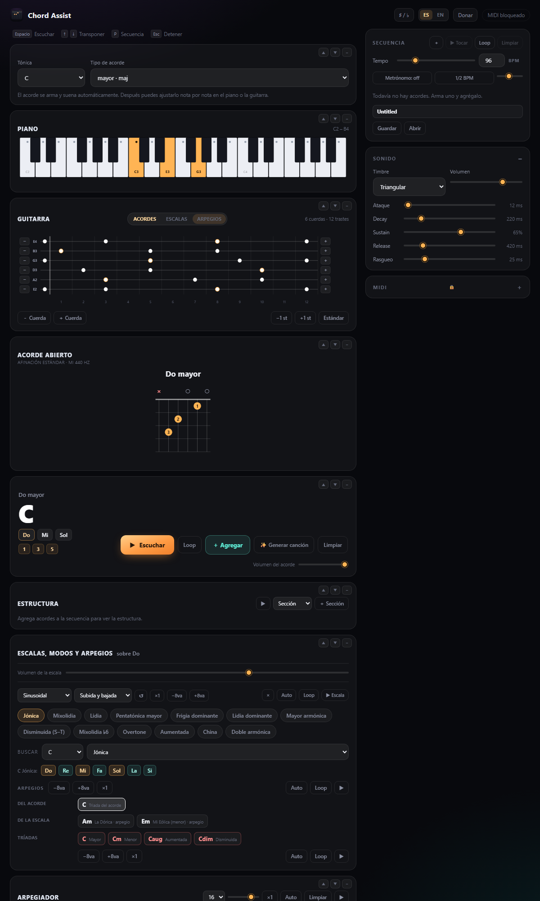

# Chord Assist

Arma acordes de dos maneras —tocando notas en el piano o el diapasón, o eligiendo tónica y tipo—, mira qué escalas y modos encajan, y encadénalos en una secuencia editable. El nombre se muestra en cifrado americano, todo suena por un sintetizador propio y sale por MIDI.

Interfaz en **castellano neutro** e **inglés** (botón ES / EN). App web standalone, sin build ni dependencias.



## Cómo abrirla

**Opción rápida:** doble clic en `index.html`. Funciona offline, con sonido.

**Opción recomendada** (habilita MIDI, la PWA y el desbloqueo):

```bash
cd chord-assist
python -m http.server 8080
```

y abrir <http://localhost:8080>.

## La interfaz

Arriba de todo están los atajos (**Espacio** escuchar, **↑ ↓** transportar, **Esc** detener). Debajo, la caja de **tónica + tipo de acorde** siempre visible, el **piano**, la **guitarra**, el **acorde actual** y las **escalas**.

### Formato 1 · Notas

Cada clic en el piano o el diapasón suma o saca una nota, suena, y el acorde se va nombrando solo.

- **Piano**: 3 octavas (C2–B4). Las notas elegidas quedan en ámbar con su nombre y octava.
- **Guitarra**: 12 trastes. Los puntos grandes son las notas exactas que elegiste (con su **grado**: `1`, `3`, `5`, `♭7`…). Los chicos marcan el resto de las posiciones del acorde; también se pueden tocar.
- **Cifrado**: si el acorde está invertido aparece con barra (`C/E`) y el bajo se pinta en rojo.

### Afinación y cuerdas

Cada cuerda tiene **−** y **+** a los costados para bajarla o subirla un semitono, con su nota al lado (`E4`, `D♯2`…). Abajo del diapasón:

- **－ Cuerda / ＋ Cuerda**: de 4 a 8 cuerdas.
- **−1 st / +1 st**: transporta **toda** la afinación de una vez. Para una guitarra en D♯ estándar alcanza con un clic en −1 st.
- **Estándar**: vuelve a E–A–D–G–B–E.

La afinación queda guardada en el navegador y se puede compartir por URL: `#tune=63,58,54,49,44,39`.

### Formato 2 · Tónica + tipo

Dos cajas: **tónica** (C…B) y **tipo de acorde** (46 tipos agrupados en tríadas, suspendidos, mayores, menores y dominantes). Al cambiar cualquiera, el acorde se arma y suena. Después puedes ajustarlo nota por nota en el piano o la guitarra.

## Escalas y modos

Debajo del acorde aparecen las escalas que contienen todas sus notas, de la más idiomática a la más exótica. Sobre `Cmaj7`: *Jónica*, *Lidia*, *Mayor armónica*…; sobre `C7`: *Mixolidia*, *Lidia dominante*, *Frigia dominante*…

- **Ámbar** = notas del acorde · **Verde agua** = notas de la escala que no están en el acorde · **Gris** = fuera de la escala.
- En el modo **Escalas** podés **agregar notas propias** para buscar escalas con ellas: esas notas se suman a la búsqueda pero **nunca modifican el acorde**, que se muestra en amarillo tenue y no se puede quitar desde esta solapa. La tónica de la escala lleva un punto rojo.
- En **Acordes**, las notas de la escala se ven como **puntos grises apagados** (ya no en azul).
- En **Arpegios** solo se dibujan las notas del arpegio elegido, como puntos blancos.
- **▶ Escala** la toca subiendo y bajando una octava (también por MIDI), con estos controles:
  - **Loop**: la repite indefinidamente (antes se cortaba en la primera vuelta, ya está corregido).
  - **Auto**: la reproduce sola cada vez que arranca un acorde o un paso de la secuencia.
  - **×1 / ×2**: duplica la velocidad de las notas.
  - **Patrón**: subida y bajada (por defecto), subida, bajada, terceras, cuartas, subir 2–bajar 1 o aleatorio. El aleatorio usa una semilla; **↺** la cambia para generar otro paseo.
  - En la secuencia, el patrón se repite durante todo el acorde y se corta justo cuando entra el siguiente (también en MIDI).
  - **−8va / +8va**: transporta la escala una octava abajo o arriba.
  - **Timbre y volumen propios**: por defecto sinusoidal al 65 %, para distinguirla del acorde.

### Acorde y escala a la vez

El motor tiene tres capas independientes (acorde, escala y secuencia): puedes dejar el acorde en **Loop** y lanzar la **escala** encima, y las dos suenan juntas. También puedes tocar la secuencia mientras practicas la escala.

**Buscador de escalas.** En la tarjeta de la guitarra hay un selector **Acordes / Escalas**:

- En **Acordes**, las sugerencias son las que contienen el acorde, con tónica en su raíz.
- En **Escalas**, agregas **3 o más notas** y te muestra **todas las escalas de cualquier tónica** que las contengan. Ejemplo: `C D E` → *C pentatónica mayor*, *A pentatónica menor*, *D egipcia*, *C jónica*, *D dórica*…

Además, la fila **Buscar** permite elegir a mano cualquier tónica y escala de la biblioteca.

### Biblioteca (37 escalas)

Los siete modos griegos, menor armónica y melódica, pentatónicas, blues, tonos enteros, disminuidas (T–S y S–T), alterada, frigia dominante, lidia dominante, locria ♮2, mayor armónica, dórica ♭2, mixolidia ♭6, lidia aumentada, aumentada, overtone, ultralocria, doble armónica, persa, egipcia, española de 8 notas, japonesa 1 y 2, iwato, hirajoshi 1 y 2, china y kumoi.

## Secuencia

- **＋ Agregar** apila el acorde **junto con la escala elegida**.
- Clic en un paso: lo carga (con su escala, su bajo y su ritmo) y lo toca.
- Cada paso tiene dos controles:
  - **×1 → ×2 → ×4 → ×8 → ×0.5 → ×0.25** = **cuántos compases** ocupa el acorde. ×0.5 dura medio compás y ×0.25 un tiempo, para acordes rápidos sin tener que subir el tempo de toda la canción.
  - **1/1 · 1/2 · 1/4 · 1/8** = **la figura con la que se golpea** dentro de esos compases: redonda (una vez por compás), blanca (dos), negra (cuatro) o corchea (ocho).
  - Ejemplo: `Emaj7 ×4` con `1/4` suena 16 veces (4 compases × 4 negras) sin tener que copiar el paso.
- **↑ ↓** para moverlo, **⧉** para copiarlo, **✎** para editarlo y **×** para borrarlo.
Para editar un acorde: hacés clic en el paso (se carga con toda su configuración), cambiás lo que quieras en las tarjetas y apretás el **lápiz de ese paso**: se guarda en el acto, en su mismo lugar.
- El **＋** del encabezado agrega el acorde actual sin bajar hasta la tarjeta del acorde.
- **✨ Generar canción**: crea una canción completa al azar (tónica y modo al azar, progresiones diatónicas típicas) con estructura de Intro, Verso, Estribillo, Puente, Interludio, Verso 2, Estribillo 2 y Outro. Pide confirmación porque **borra la secuencia actual**.
- **✎ Editar** carga ese acorde (con su escala y su ritmo) en el editor: cambias una nota, la escala o el ritmo y guardas con **✓ Guardar** en el mismo lugar de la secuencia. **Cancelar** o `Esc` salen sin tocar nada.
- **▶ Tocar** reproduce la secuencia al tempo del panel **desde el acorde seleccionado** en adelante (si no hay ninguno, arranca del primero); **Loop** la repite.
- **⇩ Guardar / ⇧ Abrir**: descarga la secuencia en JSON (con acordes, escalas, compases, figuras, BPM y afinación) o la vuelve a cargar.
- Arriba de esos botones se ve el **nombre del archivo**: `Untitled` mientras no cargues nada, y el nombre del JSON que abriste después. Al guardar, el navegador propone ese mismo nombre.

## Metrónomo

Al lado del tempo hay dos botones:

- **Metrónomo**: alterna entre **off**, **secuencia** (solo suena mientras se reproduce la secuencia) y **siempre**. Sin acento en el primer tiempo: todos los clics suenan igual. Cuando arranca la secuencia, el clic se engancha a la misma grilla que los acordes, así no se desfasa en cada cambio.
- **1/2 BPM**: el metrónomo va a la mitad de la velocidad de los acordes.
- **Volumen**: el deslizador de al lado regula el nivel del clic.

## Tempo

El tempo va de **40 a 300 BPM** y se puede escribir el número exacto, igual que en un DAW. Afecta al acorde en loop, a la escala y a la secuencia.

## Loop del acorde

**⟳ Loop** al lado de *Escuchar* repite el acorde indefinidamente (también por MIDI): elige el acorde, activa Loop, dale ▶ y practica la escala encima.

El **volumen del acorde** tiene su propio deslizador al pie de la tarjeta: no depende del volumen general del panel de sonido.

## Atajos

| Tecla | Acción |
|---|---|
| `Espacio` | escuchar / detener el acorde |
| `P` | reproducir / detener la secuencia |
| `Enter` | agregar a la secuencia |
| `↑` `↓` | transportar el acorde |
| `Esc` | detener todo el sonido (y cerrar el modal) |

## Enlaces directos (presets por URL)

```
index.html#notes=48,52,55,59                       → Cmaj7 en el piano
index.html#type=maj13&root=2                       → Dmaj13 desde el selector
index.html#notes=48,50,52&search=scales            → buscador de escalas con C D E
index.html#seq=0:maj7:2:ionian:1|9:m7:4:dorian:0.5  → Cmaj7 2 compases en negras | Am7 4 compases en corcheas
index.html#tune=63,58,54,49,44,39                  → guitarra en D♯ estándar
index.html#lang=en                                 → interfaz en inglés
index.html#modal=1                                 → ver el modal de licencias
```

- `notes`: notas MIDI (C4 = 60), separadas por coma
- `type`: id del diccionario (`maj`, `min`, `dom7`, `maj7`, `m7`, `m7b5`, `13s11`…)
- `root`: 0 (C) a 11 (B)
- `search`: `scales` abre el buscador de escalas
- `seq`: pasos `tónica:id:compases:escala:figura` (figura opcional: `4`, `2`, `1` o `0.5`)
- `tune`: afinación, de la 1ª cuerda a la más grave
- `lang`: `es` o `en`

## Desbloqueo y licencias

La app es gratis. La **salida MIDI** y la **exportación JSON** se desbloquean con un **código de licencia** personal, que se compra una sola vez.

- **Comprar**: botón **Comprar** en la cabecera (o en el modal) → abre `buy.html` en otra pestaña, con el botón de PayPal.
- Después del pago, el bot del VPS recibe el webhook y **envía el código por email**.
- En la app: **Desbloquear** → pegás el código → se valida online contra el bot y queda guardado en el navegador.
- Si el código fue anulado (reembolso), la app se vuelve a bloquear al abrirse.
- La app no tiene llave maestra pública: las licencias de soporte se emiten en el servidor con `npm run issue`.

El modal aparece al tocar **Comprar** y también cada 5 minutos como recordatorio.

## Cómo está armado

```
index.html            estructura y modal de licencia
css/styles.css        tema oscuro, layout responsive
js/theory.js          46 acordes y 37 escalas, identificación, grados (sin DOM)
js/i18n.js            textos en castellano neutro e inglés
js/audio.js           sintetizador Web Audio: voces, ADSR, reverb, melodías
js/midi.js            Web MIDI out (manda las mismas notas que suenan)
js/app.js             estado, piano, guitarra, acorde, escalas, secuencia, desbloqueo
tests/theory.test.js  pruebas del núcleo musical (node tests/theory.test.js)
sw.js                 cache offline
manifest.webmanifest  PWA
```

El estado central es un conjunto de **notas MIDI**. De ahí salen las pitch classes, el bajo, el cifrado, el piano, la guitarra y la secuencia.

La identificación prueba las 12 raíces contra los 46 acordes y, cuando hay ambigüedad, **prioriza la raíz que coincide con el bajo**: `C-E-G-A` con Do en el bajo es `C6`; con La en el bajo es `Am7`.

## Límites conocidos

- **Web MIDI** requiere `localhost` o `https`; con `file://` el botón avisa y no funciona.
- La salida MIDI manda el acorde en bloque, no reproduce el rasgueo exacto del sintetizador.
- Algunas escalas exóticas tienen variantes según el libro de referencia.
- El audio del navegador tiene ~10 ms de latencia: ideal para practicar, no para grabación sample-accurate.

## Próximos pasos posibles

1. Validación de códigos en servidor (licencias reales).
2. Presets de afinación con nombre ("D♯ estándar", "Drop D", "7 cuerdas B").
3. Exportar también a MIDI / WAV.
4. Arpegiador y patrones de ritmo para la secuencia.
5. Empaquetado como app de escritorio con Tauri.
